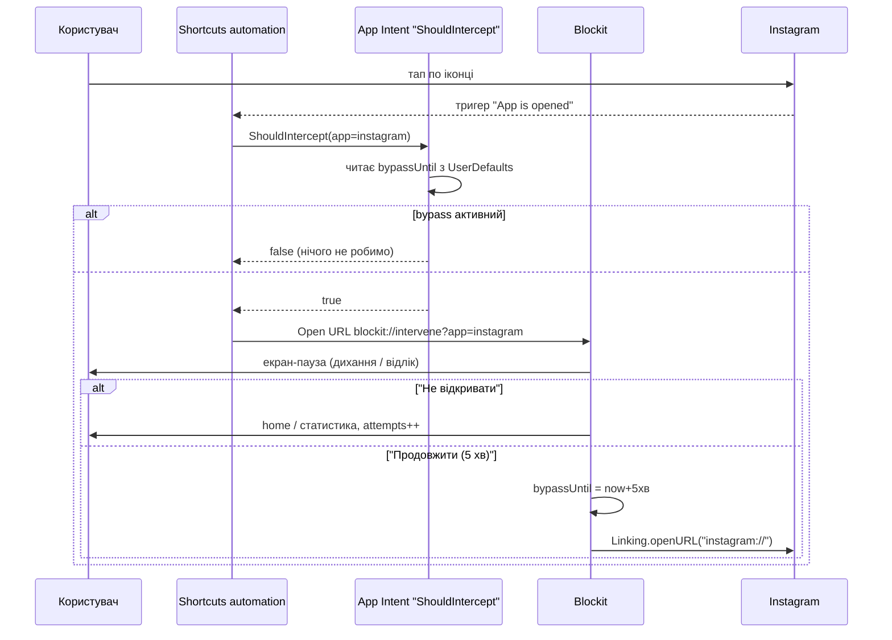

> Archived Shortcuts-era document. Current design and release checks: context-blockit.md and SCREEN_TIME_QA.md.

# План v2: клон one sec (Blockit), спершу iOS, Expo / React Native

> [!IMPORTANT]
> Це інструкція для AI-агента (Gemini). Умови: розробка на **Windows**, Mac немає, **публічний GitHub-репо** (macOS runners безкоштовні), є iPhone, Apple Developer акаунта поки немає. Android відкладаємо, але з RN він потім дістанеться майже безкоштовно.

---

## 1. Чому Expo / React Native, а не Flutter

**Чи можна зовсім без нативного коду?** Майже. Автоматизація Shortcuts може просто відкрити `blockit://intervene?app=instagram`, і на це нативний код не потрібен. Проблема в **циклі**: коли ми повертаємо користувача в Instagram, автоматизація спрацьовує знову. Без нативу є тільки один вихід: застосунок на мить відкривається і, якщо діє bypass, одразу «відстрибує» назад, тобто екран блимає.

Правильне рішення — один маленький **App Intent на Swift (~40 рядків)**: «Чи треба перехоплювати X?» → `true/false`. Shortcut робить `If true → Open URL`, і тоді нічого не блимає. Весь інший застосунок (UI, інтервенції, статистика, налаштування) — це TypeScript.

| | **Expo / RN** ✅ | Flutter |
|---|---|---|
| Hot reload **на реальному iPhone з Windows** | ✅ dev-client ставиться через Sideloadly і підключається до Metro на Windows по Wi-Fi | ❌ `flutter run` на iOS потребує Mac |
| Додати Swift (App Intent, extensions) | Expo config plugin / local module | Руками в `ios/Runner` (на Windows незручно) |
| Готові бібліотеки Screen Time (на майбутнє) | `react-native-device-activity` | майже немає |
| Логіка й тести на Windows | Jest | `dart test` |

**Висновок:** Expo (SDK 52+, New Architecture), TypeScript, `expo-router`. Нативна папка `ios/` генерується (`expo prebuild`) і **не комітиться**: увесь натив описується config plugins.

---

## 2. Як воно працює (режим Shortcuts)



- **Спільний стан** між JS і Intent: `UserDefaults` (App Intent з main target виконується в процесі застосунку, тож App Group не потрібен, а з безкоштовним Apple ID App Groups можуть і не працювати). JS пише туди через маленький Expo module `BlockitBridge` (`setBypass`, `getAttempts`).
- **Онбординг:** готовий Shortcut через iCloud-лінк + покрокова інструкція (відео), як створити автоматизацію «App is opened → Run immediately» (на iOS 17+ можна без підтвердження).

> [!WARNING]
> **Технічна пастка:** метадані App Intents (`Metadata.appintents`) генеруються **тільки для коду в main app target**, а не в CocoaPods/static lib. Тому Swift-файл intent'а додається config plugin'ом **прямо в target застосунку**. CI мусить перевіряти, що `Blockit.app/Metadata.appintents` існує, інакше дія просто не з'явиться в Shortcuts.

---

## 3. Скоуп (iOS, MVP → повний)

| Фіча | Фаза |
|---|---|
| Deep link → інтервенція → «Не відкривати» / «Продовжити N хв» → повернення в ціль | 2 |
| App Intent `ShouldIntercept` + онбординг Shortcuts | 2 |
| Інтервенції: дихання, відлік, рефлексія-питання, набір фрази, зростаюча затримка | 3 |
| Список застосунків (каталог URL-схем: instagram, tiktok, youtube, x, facebook, reddit, telegram…) + налаштування для кожного | 3 |
| Статистика: спроби, відмови, «збережений час», графіки | 4 |
| Розклад, денні ліміти, жорсткий режим | 4 |
| Віджет (WidgetKit через `@bacons/apple-targets`) | 5 |
| Pro-підписка (RevenueCat / `expo-iap`) | 5 |
| **Screen Time Shield** (`react-native-device-activity`) | 6, ⚠️ потрібен акаунт за \$99 |
| Android (AccessibilityService, Expo module на Kotlin) | 7, пізніше |

---

## 4. Структура репо

```
blockit/
├─ app/                     # expo-router екрани
├─ src/
│  ├─ core/                 # rules engine — чистий TS, 0 залежностей від RN
│  ├─ features/             # intervention, apps, stats, schedule, onboarding
│  ├─ storage/              # MMKV/SQLite + BlockitBridge
│  └─ i18n/                 # uk, en
├─ modules/blockit-bridge/  # local Expo module (Swift): UserDefaults bridge
├─ plugins/
│  └─ withAppIntent.ts      # додає ios-native/ShouldInterceptIntent.swift у main target
├─ ios-native/              # Swift-файли, які плагін вставляє в target
├─ e2e/maestro/             # E2E-флоу
├─ spec/                    # PRODUCT.md, rules-engine.md, MANUAL_QA.md
├─ app.config.ts
└─ .github/workflows/
```

---

## 5. Фази

### Фаза 0: каркас + CI (1–2 дні)
- [ ] `create-expo-app` (TS), ESLint, Prettier, Jest, `expo-router`, `expo-dev-client`
- [ ] `ci.yml` (ubuntu): `tsc --noEmit`, lint, `jest`
- [ ] `ios-build.yml` (macos-15): `expo prebuild -p ios` → `pod install` → `xcodebuild` для симулятора та **unsigned dev-client `.ipa`** → artifacts
- [ ] **DoD:** обидва workflow зелені; ти ставиш dev-client через Sideloadly, запускаєш `npx expo start` на Windows, і застосунок на iPhone підвантажує JS по Wi-Fi з hot reload

### Фаза 1: rules engine (1–2 дні, повністю на Windows)
- [ ] `decide(event, config, state, now) → Allow | Intervene{type, seconds, attemptNo} | Block`
- [ ] bypass-вікно, зростаюча затримка, ліміти, розклад, скидання опівночі (таймзони/DST)
- [ ] **DoD:** ≥40 Jest-кейсів, покриття `src/core` ≥90%

### Фаза 2: перехоплення (3–4 дні). Ключова фаза
- [ ] `blockit://intervene?app=…`: обробка в `expo-router` (холодний і теплий старт)
- [ ] `BlockitBridge` (Swift Expo module): `setBypass(app, until)`, `getBypass(app)`, лічильники
- [ ] `withAppIntent` plugin + `ShouldInterceptIntent.swift` (`AppIntent` + `AppShortcutsProvider`, параметр app як `AppEnum`)
- [ ] Повернення в ціль `Linking.openURL(scheme)`, фолбек на App Store, якщо схема не відкривається
- [ ] Перевірка в CI: `test -d Blockit.app/Metadata.appintents`
- [ ] **DoD:** Maestro на симуляторі проходить deep link → пауза → «Продовжити» → bypass записаний. Ручний тест на iPhone за `MANUAL_QA.md` з реальним Instagram

### Фаза 3: інтервенції та керування застосунками (4–5 днів)
- [ ] Анімації `react-native-reanimated` (дихання, відлік), haptics
- [ ] Екран застосунків і налаштувань кожного; онбординг з iCloud-лінком на Shortcut
- [ ] uk/en, dark mode, Dynamic Type

### Фаза 4: статистика, розклад, ліміти (3–4 дні)
- [ ] SQLite (`expo-sqlite`) журнал подій; графіки (`victory-native` / Skia)

### Фаза 5: віджет, підписка, полірування (3–4 дні)

### Фаза 6: Screen Time (після покупки акаунта)
- [ ] `react-native-device-activity`, Shield/ShieldAction/Monitor extensions через `@bacons/apple-targets`
- [ ] fastlane / EAS Submit → TestFlight; заявка на Family Controls distribution
- [ ] Код за feature flag, щоб збірка без entitlement не ламалася

---

## 6. Тестування

| Рівень | Інструмент | Де | Як бачиш результат |
|---|---|---|---|
| Логіка | Jest | **Windows** + CI ubuntu | одразу в терміналі |
| Компоненти / екрани | React Native Testing Library | **Windows** + CI | одразу |
| Швидкий UI-перегляд | Expo web (`npx expo start --web`) | **Windows** | у браузері (без нативних частин) |
| E2E iOS | **Maestro** на iOS-симуляторі; `xcrun simctl openurl` для deep links | CI macos-15 | **відео + скріншоти** в artifacts |
| Нативні перевірки | наявність `Metadata.appintents`, URL scheme в `Info.plist` | CI | лог job'а |
| Реальний пристрій | dev-client (hot reload) / release `.ipa` через Sideloadly | iPhone | ти, за `spec/MANUAL_QA.md` |

> [!NOTE]
> Автоматизацію Shortcuts («App is opened») **неможливо запустити в CI**, бо її тригерить тільки реальний iOS. Тому все до і після неї покривається автотестами (deep link, логіка intent'а, bypass), а сам тригер перевіряється вручну на iPhone. Логіка intent'а мінімальна (прочитати timestamp, порівняти), щоб ризик був мінімальний.

**Обмеження безкоштовного Apple ID (Sideloadly):** підпис живе 7 днів (перепідписуєш щотижня), до 3 застосунків одночасно, жодного Screen Time. Для режиму Shortcuts цього достатньо.

---

## 7. CI (публічний репо → macOS безкоштовно)

| Workflow | Runner | Що |
|---|---|---|
| `ci.yml` | ubuntu | typecheck, lint, Jest + coverage |
| `ios-build.yml` | macos-15 | prebuild → build sim + unsigned dev-client `.ipa` + unsigned release `.ipa` → artifacts |
| `ios-e2e.yml` | macos-15 | sim build → Maestro → відео/скріни |

Ключовий крок збірки unsigned `.ipa`:

```yaml
- run: npx expo prebuild -p ios --clean
- run: cd ios && pod install
- run: |
    xcodebuild archive -workspace ios/Blockit.xcworkspace -scheme Blockit \
      -configuration Release -destination 'generic/platform=iOS' \
      -archivePath build/Blockit.xcarchive CODE_SIGNING_ALLOWED=NO
    test -d build/Blockit.xcarchive/Products/Applications/Blockit.app/Metadata.appintents
    mkdir -p build/Payload && cp -R build/Blockit.xcarchive/Products/Applications/Blockit.app build/Payload/
    cd build && zip -qr Blockit-unsigned.ipa Payload
- uses: actions/upload-artifact@v4
  with: { name: Blockit-ipa, path: build/Blockit-unsigned.ipa }
```

---

## 8. Правила для Gemini

1. **Не комітити `ios/`.** Увесь натив описується через `app.config.ts`, `plugins/`, `modules/`, `ios-native/`.
2. Бізнес-логіка живе тільки в `src/core` (чистий TS) і покривається Jest **до** UI.
3. Перед пушем запускати локально: `npx tsc --noEmit && npm run lint && npx jest`.
4. Після пушу: `gh run watch` → при падінні `gh run view --log-failed` → виправити. Задача закрита, тільки коли CI зелений.
5. Swift-код локально не компілюється, тому тримати його мінімальним і перевіряти в CI.
6. Кожна фаза закінчується PR зі скріншотами/відео з artifacts і оновленим `spec/MANUAL_QA.md`.
7. Мінімальна iOS: **16.0** (App Intents).

---

## 9. Що потрібно від тебе

- [ ] Публічний GitHub-репо + `gh` CLI (`gh auth login`)
- [ ] Node 20 LTS на Windows
- [ ] Sideloadly + iTunes (драйвери iPhone), Developer Mode на iPhone увімкнений
- [ ] iPhone і ПК в одній Wi-Fi мережі (для Metro)
